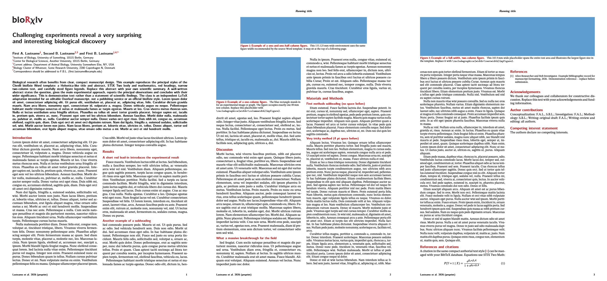

# bioRxiv-inspired LaTeX template

An **Overleaf-ready, two-column LaTeX manuscript template** inspired by the typography of the [bioRxiv Word template by Chrelli](https://github.com/chrelli/bioRxiv-word-template).

> **Unofficial template:** this is an independent LaTeX adaptation, not an official bioRxiv document class or a guarantee of compliance with any journal's submission requirements.

## Preview

<p align="center">
  <a href="preview/main.pdf">
    
  </a>
</p>

<p align="center">
  <a href="preview/main.pdf"><strong>View full sample PDF</strong></a>
  &nbsp;·&nbsp;
  <a href="https://github.com/IoSonoMarco/bioRxiv-Template---Latex/archive/refs/heads/main.zip"><strong>Download template ZIP</strong></a>
</p>

## Quick start

1. [Download the repository as a ZIP](https://github.com/IoSonoMarco/bioRxiv-Template---Latex/archive/refs/heads/main.zip).
2. In **Overleaf**, create a project by uploading the ZIP.
3. In the project settings, select **XeLaTeX** as the compiler.
4. Compile **`main.tex`**, then replace the sample metadata, text, figures, and references with your own content.

**Important:** Keep `biorxiv-chrelli.cls` and `biorxiv-logo.pdf` alongside `main.tex`. The template requires XeLaTeX or LuaLaTeX; pdfLaTeX is not supported.

## Features

- Two-column A4 layout inspired by the bioRxiv Word design, with red headings and compact typography.
- STIX Two Text/Math and a Helvetica-like sans-serif font for display elements.
- Optional bioRxiv wordmark, with adjustable width.
- Example one-column (89 mm), 1.5-column (133.125 mm), and full-width (183.9 mm) figures.
- Numeric, APA-like author–year, or Nature-like superscript citations through `natbib`.
- Custom commands for manuscript metadata, section lead-ins, and methods text.

## Command reference

The commands below are a **quick reference**. Commands labeled **Template** are defined by `biorxiv-chrelli.cls`; commands labeled **LaTeX** are standard LaTeX commands or provided by the included packages.

| Command | Type | What it does |
|:--|:--|:--|
| `\documentclass{biorxiv-chrelli}` | LaTeX | Loads the custom manuscript class. |
| `\ShowBioRxivLogo` | Template | Shows the bioRxiv wordmark above the title. |
| `\HideBioRxivLogo` | Template | Hides the wordmark and its reserved spacing. |
| `\SetBioRxivLogoWidth{31.7mm}` | Template | Changes the wordmark width. |
| `\PaperTitle{...}` | Template | Sets the manuscript title. |
| `\PaperAuthors{...}` | Template | Sets the author list. |
| `\PaperAffiliations{...}` | Template | Sets institutions and correspondence details. |
| `\affilmarker{1}` | Template | Inserts a red superscript affiliation marker. |
| `\PaperAbstract{...}` | Template | Sets the abstract in the title block. |
| `\RunningTitle{...}` | Template | Sets the running header on subsequent pages. |
| `\FooterCitation{...}` | Template | Sets the footer citation text. |
| `\UseAPAReferences` | Template | Enables author–year citations; pair with `apalike`. |
| `\UseNatureReferences` | Template | Enables superscript numeric citations; pair with `unsrtnat`. |
| `\maketitle` | LaTeX | Prints the title, authors, affiliations, and abstract. |
| `\section{...}` | LaTeX | Starts a red, unnumbered section. |
| `\subsection{...}` | LaTeX | Starts a smaller red, unnumbered subsection. |
| `\subsubsection{...}` | LaTeX | Starts a red, run-in subsubsection. |
| `\ResultsLead{...}` | Template | Adds a red, bold lead-in heading in the main text. |
| `\MethodsLead{...}` | Template | Adds a smaller red lead-in heading for methods. |
| `\BodyText` | Template | Applies the default manuscript body text size. |
| `\MethodsText` | Template | Applies the smaller methods text size; use within a group. |
| `\FigureLegendText` | Template | Applies the figure-caption text size when needed manually. |
| `\legendtitle{...}` | Template | Formats the red, bold opening phrase of a figure caption. |
| `\begin{figure} ... \end{figure}` | LaTeX | Creates a one-column figure. |
| `\begin{figure*} ... \end{figure*}` | LaTeX | Creates a figure spanning both columns (also used for the 1.5-column example). |
| `\caption{...}` / `\label{...}` | LaTeX | Adds a caption and cross-reference label. |
| `\citep{key}` / `\citet{key}` | `natbib` | Inserts parenthetical or textual citations, according to the selected style. |
| `\bibliographystyle{...}` | LaTeX/BibTeX | Chooses the bibliography formatting style. |
| `\bibliography{references}` | LaTeX/BibTeX | Prints references from `references.bib`. |

### Minimal manuscript structure

```latex
\documentclass{biorxiv-chrelli}

\ShowBioRxivLogo  % Optional; comment out to hide the logo

\PaperTitle{Your manuscript title}
\PaperAuthors{Jane Doe\affilmarker{1}, John Smith\affilmarker{2}}
\PaperAffiliations{%
  \affilmarker{1}First institution\\
  \affilmarker{2}Second institution
}
\PaperAbstract{A concise summary of your research.}
\RunningTitle{Short manuscript title}
\FooterCitation{Doe et al. (preprint)}

\begin{document}
\maketitle

\section{Introduction}
Your introduction goes here.

\section{Results}
\ResultsLead{A short heading highlighting a finding}
Your results go here.

\section{Materials and Methods}
{\MethodsText
\MethodsLead{Experimental procedure}
Describe your methods here.
}

\section{Discussion}
Your discussion goes here.

\bibliographystyle{unsrtnat}
\bibliography{references}
\end{document}
```

## Customize the logo

The class **hides the wordmark by default**. The provided `main.tex` shows it by explicitly calling `\ShowBioRxivLogo` after `\documentclass`.

```latex
\ShowBioRxivLogo              % Show the logo
% \HideBioRxivLogo            % Hide it (or simply omit \ShowBioRxivLogo)
\SetBioRxivLogoWidth{31.7mm}  % Optional width adjustment
```

`biorxiv-logo.pdf` is the vector asset LaTeX uses; `biorxiv-logo.svg` is the editable vector source. The wordmark is horizontally cropped to align with the manuscript text.

## Citations and bibliography

The class already loads **`natbib`**, so do not load it again. Choose **one** citation mode in the preamble, and match the bibliography style at the end of your document:

| Citation mode | Preamble | Bibliography style | In-text appearance |
|:--|:--|:--|:--|
| **Numeric (default)** | No extra command | `\bibliographystyle{unsrtnat}` | `[1,2]` |
| **APA-like author–year** | `\UseAPAReferences` | `\bibliographystyle{apalike}` | `(Smith et al., 2026)` |
| **Nature-like superscripts** | `\UseNatureReferences` | `\bibliographystyle{unsrtnat}` | Superscript `1,2`, without brackets |

For numeric citations, `plainnat` is another option if you prefer alphabetically sorted bibliography entries. `apalike` is **not strict APA 7**, and the Nature-like option is **not a certified Nature bibliography style**.

Write citations using `\citep{key}` or `\citet{key}`, then include:

```latex
\bibliography{references}
```

When switching between numeric and author–year styles in Overleaf, **recompile from scratch** so BibTeX regenerates its cached files. Do not activate `\UseAPAReferences` and `\UseNatureReferences` together.

## Figures

The included sample illustrates three useful figure widths:

| Figure | Width | Recommended environment |
|:--|--:|:--|
| One column | 89 mm | `figure` |
| One-and-a-half columns | 133.125 mm | `figure*` with a `minipage` of that width |
| Full width | 183.9 mm | `figure*` |

For example, a one-column figure can be written as:

```latex
\begin{figure}[t]
  \centering
  \includegraphics[width=\columnwidth]{myfigure}
  \caption{\legendtitle{Main finding.} Explain the figure here.}
  \label{fig:example}
\end{figure}
```

Figures using `figure*` are double-column floats and may appear at the top of a following page rather than at their exact position in the source. Refer to `main.tex` for working examples of all three widths.

## Project files

| File | Purpose |
|:--|:--|
| `main.tex` | Editable example manuscript. |
| `biorxiv-chrelli.cls` | Layout, typography, and custom commands. |
| `references.bib` | Example bibliography database. |
| `biorxiv-logo.pdf` / `biorxiv-logo.svg` | Vector logo asset and editable source. |
| `preview/cover.png` | Three-page horizontal preview shown above. |
| `preview/main.pdf` | Compiled example manuscript. |

## License and attribution

See [LICENSE](LICENSE) for the repository license (GPL-3.0). Inspired by the [Chrelli bioRxiv Word template](https://github.com/chrelli/bioRxiv-word-template); this repository is independently maintained and is not affiliated with or endorsed by bioRxiv.
